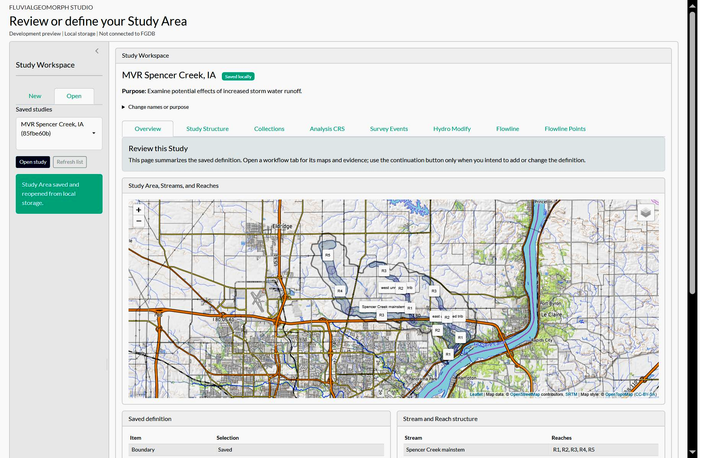

# FluvialGeomorph Studio

**FG Studio helps analysts turn a stream-study question into an explicit,
reusable study definition and a documented terrain foundation.** It is the
implementation-first R Shiny workspace for the open-source FluvialGeomorph
workflow, which uses remotely sensed terrain and shared R methods to characterize
stream geometry.

The implemented path now runs from Study Area, Stream, and Reach definition
through source acquisition, Stream DEM assembly, hydro modification, synthetic
Stream Network extraction, automatic Reach Flowlines, and Study-wide Flowline
Points. Maps, guided choices, and saved evidence make those steps reviewable while
keeping consequential scientific decisions with the analyst. Level 1 analysis,
report delivery, and governed FGDB publication remain later workflow increments.

The [Analyst Guide](vignettes/guide-study-workflow.Rmd) follows this workflow with
completed-state screenshots from the Spencer Creek development study.

## Find your starting point

| Your question | Start here |
| --- | --- |
| Why does this app exist, and how does it fit the project? | [FG Studio in FluvialGeomorph](vignettes/fgstudio.Rmd) |
| How do I work from study definition through Flowline Points? | [Working with a Study Area](vignettes/guide-study-workflow.Rmd) |
| How do I trace behavior, diagnose a defect or extend the app? | [Application lifecycle](vignettes/dev-02-application-lifecycle.Rmd), then the relevant developer article |
| How are we testing better human and agent context routing? | [Code maps and dual-mode development](vignettes/dev-01-code-navigation.Rmd) |
| How do I launch an installed package from R? | `fgstudio::run_app(data_dir = "path/to/studio-data")` |

The analyst guide includes the development-workstation launch procedure and
storage details. The site also provides R API reference for the app entry points.

## A client within a shared scientific project

FG Studio owns browser interaction, workflow state, and local-study orchestration.
**fluvgeo** owns reusable open-source scientific methods, spatial validation, and
the replacement functions for legacy ArcPy processing. **FluvialGeomorph-toolbox**
remains the production legacy implementation while those replacements are proven
stepwise; **ohwm2** established the successful pattern of moving reusable Shiny
geospatial work into fluvgeo. Developing **QGIS** tools can use the same backend
through a desktop interface.

**FGDB** owns governed identities, relationships, compatibility contracts, and
eventual enterprise persistence. Alignment is iterative: accepted FGDB invariants
constrain implementation, while grounded FG Studio development reveals physical
schema and interoperability requirements that must be reconciled back into FGDB.
The **User Manual** and **Technical Manual** retain project-wide procedure and
method authority. The [project overview](vignettes/fgstudio.Rmd) explains these
relationships and the compatibility-preserving migration strategy.

## Implemented workflow

- Create and reopen a local Study Area; define its boundary, Streams and Reaches.
- Discover Survey Collections, record acquisition intent, select and download
  source DEM tiles, and inspect their metadata and terrain previews.
- Specify a planar horizontal analysis CRS and a separate vertical target,
  elevation units and optional epoch/model metadata.
- Configure Survey Events and cell sizes; assemble and reopen Stream DEM editions
  with same-CRS bilinear resampling and retained processing evidence.
- Inspect elevation/hillshade in Hydro Modify, draw and reopen cutlines, and save
  hydro-modified DEMs while preserving their source and method provenance.
- Automatically select and review a smoothed mainstem Flowline from a saved
  synthetic Stream Network using the previously chosen NHDPlusV2 Stream as
  reference evidence, with a conservative 2 m default and selectable 2–5 m
  smoothing candidates; divide and save the selected path as exact-input Reach
  Flowlines automatically.
- Create and reopen one-meter Flowline Points across every connected Stream and
  Reach in a Survey Event, with legacy-compatible fields, Study-wide
  `km_to_mouth` stationing, sampled elevations, and combined profile review.
- Retain saved revisions and source evidence as the study evolves.

The current release is a **trusted, single-analyst local development preview**,
not a shared hosted service or governed delivery system. Current/base-event
Flowline Points are implemented; comparison-event calibration remains later work.
Datum-operation review and explicit selection are available, but execution of
selected cross-CRS pipelines remains pending. Saving a CRS specification does not
transform elevations or establish data fitness.

## Documentation as part of development

This site serves analysts, reviewers, and maintainers. The Analyst Guide follows
the implemented workflow; numbered developer articles explain events, state,
backend calls, persistence, failures, and tests. Compact routes and generated
code maps point to the same source and contracts. Human developers must be able
to maintain the application without an agent or conversation history, and no AI
service is required to run FG Studio.

Build the local pkgdown site with `./dev/scripts/build-docs.ps1`, then open
`docs/index.html`. This builds documentation without publishing it or changing
saved studies. Repository contributors should also read `AGENTS.md` and
`dev/goals/project-plan.md` before changing a workflow.
