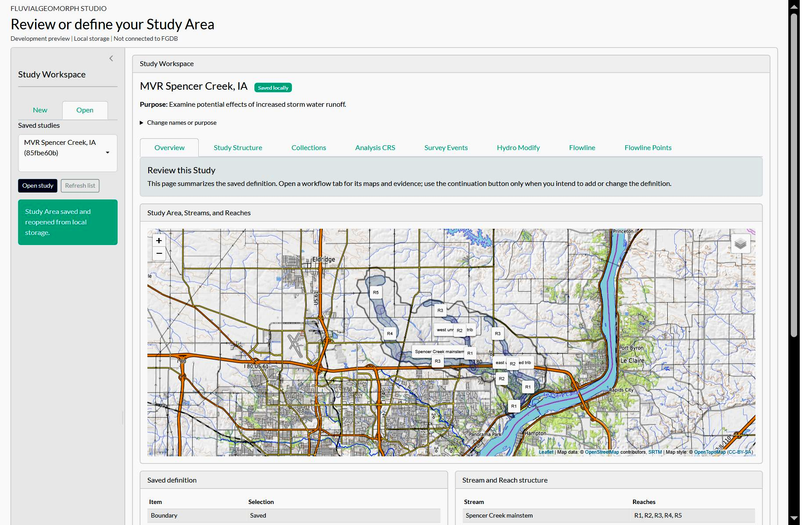
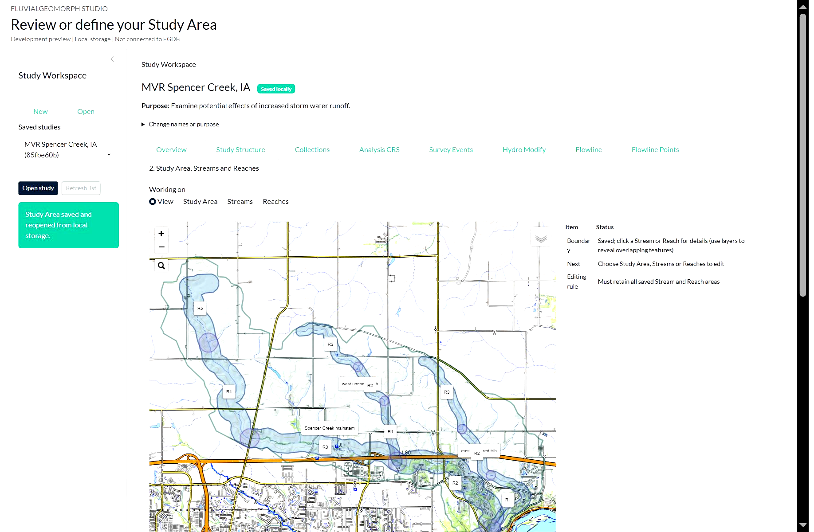
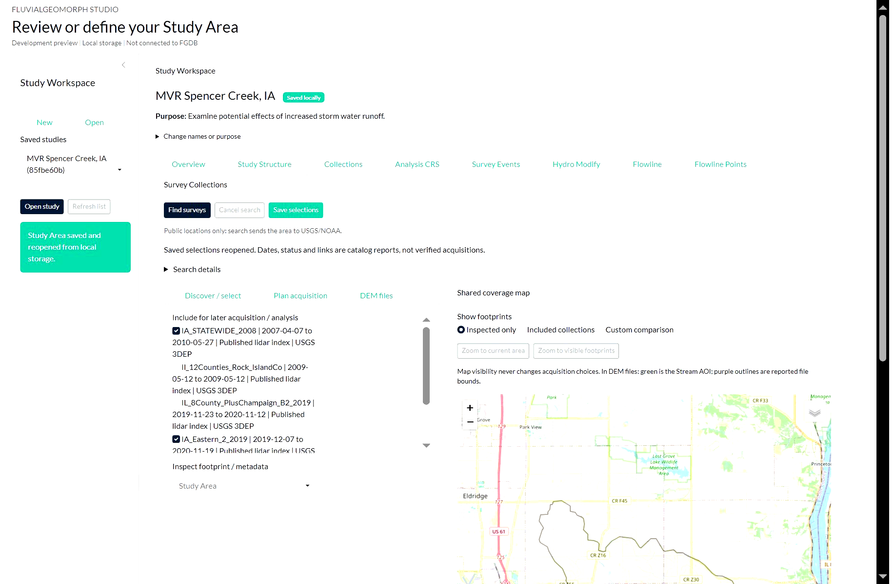
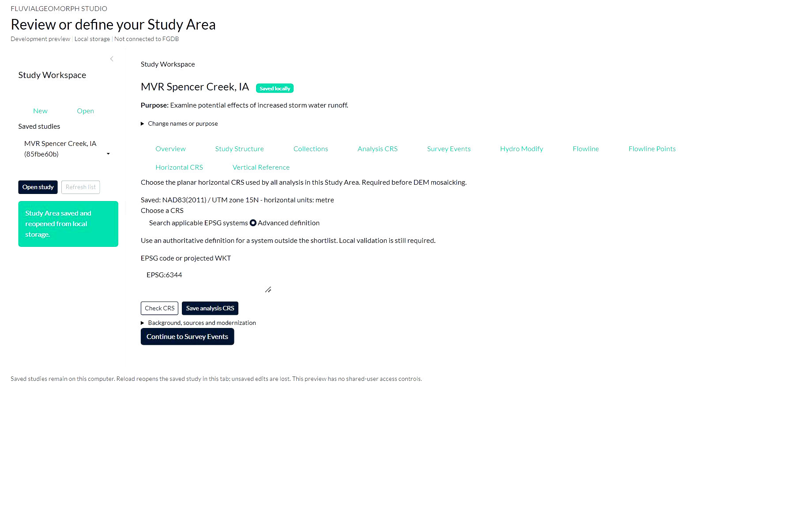
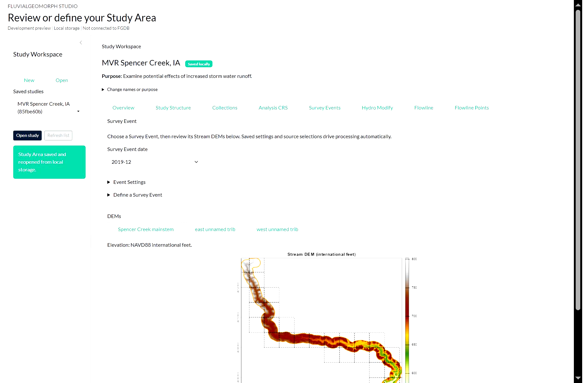
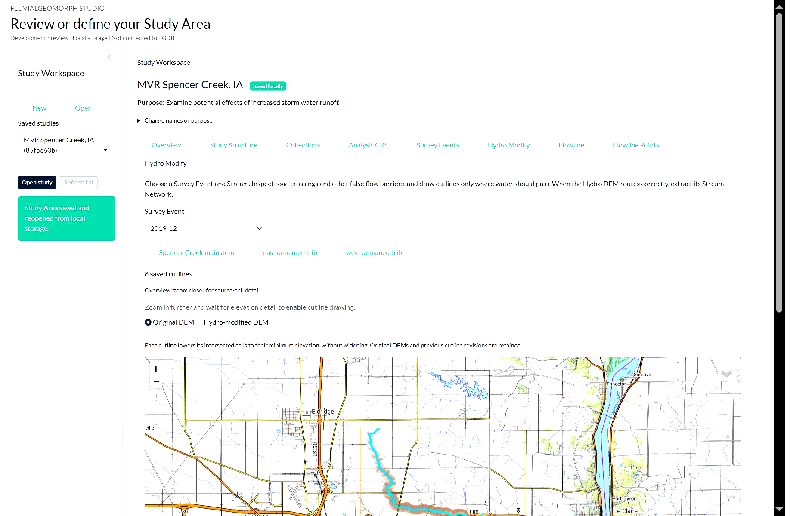
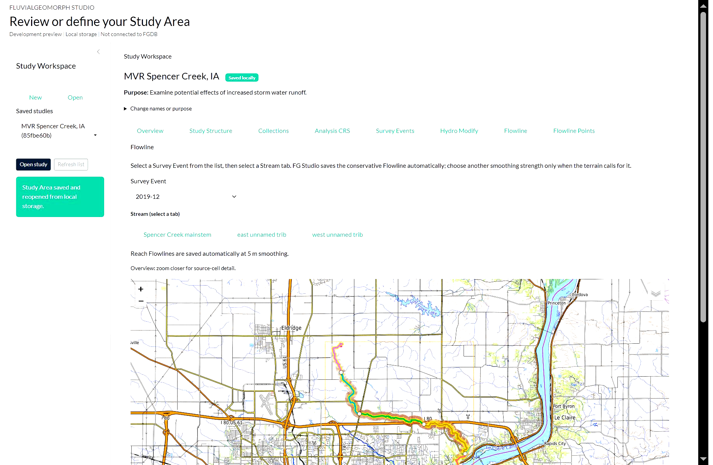
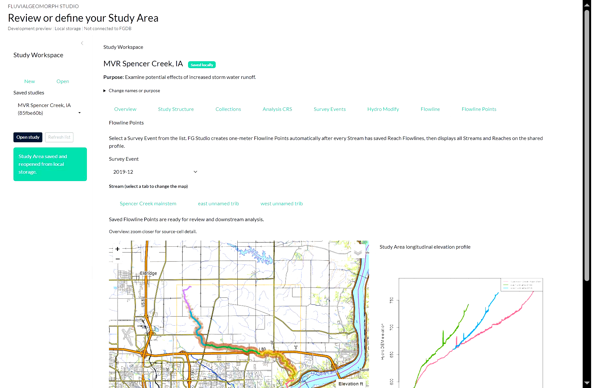

This guide covers the implemented local preview. Start with
[FG Studio in the FluvialGeomorph project](fgstudio.html) for its purpose,
shared scientific foundation and planned place in the analysis workflow.
Use the contents list to jump to the operation you need; the app supports
iterative study design rather than requiring every operation in a fixed order.

## Start or reopen a study

1. Enter a working Study Area name and optional purpose/customer question.
2. Select **Create Study Area**. The app saves a real fluvgeo context GeoPackage
   and reads it back before opening **Study Structure** for initial definition.
3. Reopening a saved study lands on **Overview** instead. Review its Purpose,
   boundary, Stream/Reach hierarchy, analysis references, and Survey Event
   definitions before opening a detail tab.
4. Reload reopens the latest saved revision of this tab's study, including both
   CRS specifications. The URL contains only its opaque local study key; it works
   on this workstation's data store. A fresh URL without a key starts empty; use
   **Workspace - Open** to choose a saved study.
5. Choose **Workspace - New** to start another; saved studies remain intact and
   the previous key is removed from the URL. That action confirms discarding
   pending edits. Browser reload itself discards unsaved edits, checks and previews.

## Review or continue defining a saved study

**Overview** is the read-only starting point for a saved Study Area. Its Saved
definition table reports which core choices exist, and its hierarchy and Survey
Event tables show the actual Stream/Reach organization, collection membership,
assigned Streams, and output cell sizes. The map shows the saved Study Area,
Streams and Reaches with labels, providing spatial context without entering an
editing mode. Use the main tabs to inspect the owning
maps and evidence. Those tabs also contain the editing controls for the definition
they own.

The complete Spencer Creek development study illustrates the first review stage:
the saved definition and spatial context appear together before the analyst enters
an editing workflow.

{fig-alt="A saved Study Area overview with definition summaries and a context map." width="100%"}

Use **Continue defining or updating** only when you intend to move forward from
the saved definition. FG Studio routes that button to the first incomplete step,
or to Hydro Modify when the prerequisite definition exists. It does not rerun a
calculation from Overview. Study name, Purpose, Stream-name and Reach-name changes
are grouped under **Change names or purpose** below the saved Study title so they
do not compete with routine review.

## Rename saved Streams or Reaches

Choose **View** above the map to see saved Stream/Reach names and click an area
for its identity and parent details. Toggle layers to reveal overlapping areas.
Editing modes reserve map clicks for their active tool. Saved-feature dropdowns
zoom to the selected geometry; rename lists sort alphabetically. Reach rename
choices display **Stream / Reach**, ordered by Stream then Reach name.
**3. Saved Streams and Reaches** lists the nested hierarchy and area status.

Use **Rename Stream** or **Rename Reach** beside the study title, choose the
saved record, edit its name and **Save name**. Save or Clear unfinished geometry
selections first. Names must be unique within their parent. Only the display
name changes; IDs, geometry, Survey Events and earlier revisions are retained.

Channel candidate lists run **downstream to upstream**, for both upstream and
downstream search results and retained Reach segments. Branch ordering is
deterministic, not a mainstem choice or station numbering. Unsupported topology
is marked **Order unresolved**; geometry is never reversed or repaired to sort it.
Saved-Reach cuts are available through **Split existing**. Pre-assembly and
Stream cutting remain later steps of the approved design.

## Draw a boundary

Not sure where the study should end? Choose **Study Area - Select watersheds** (also
available before creating a study). Click near a channel, select **Snap to stream**,
review the orange channel and snapped point, then **Explore this stream**. Compare
the HUC12, upstream basin and upstream/downstream channels using the layer control.
Black marks your original click. Requests may be cancelled. Click within 200 m of
a mapped channel; distant downstream tracing is not substituted for snapping.

In Explore mode, zoom in to see **NHDPlusV2 reference channels** in blue before
clicking. This is a lightweight USGS vector-tile overlay, not a full geometry
download into R. The map layer control can hide it. Display tiles are generalized
guidance; snapping still uses the service's network. Viewed tile coordinates go
to USGS. If a service request fails, retry the same selected point; expand
**Last failed request details** to distinguish transport errors from unresolved
responses. A blank reference layer is not proof that streams are absent.

On wider screens, map and exploration controls appear side by side. Expand any
of the four **Discovered features** lists to see supplied names and source IDs.
Repeated names remain separate features; unnamed channels are labeled honestly.
Selection alone does not save a boundary. Each type distinguishes **Request
failed**, **No matches**, and **Unresolved** when the service client did not retain
enough evidence to tell the difference. Sources and longer explanations remain
available in collapsed sections.

These are reference candidates for deciding Study Area and Stream scope, not saved
FG records. The basin is catchment-based, not an exact pour-point delineation;
channel results are distance-limited. Exploration sends the selected coordinates
to USGS public services, not your saved study boundary/name/purpose.

### Select a watershed boundary

1. Discover polygons, then choose **Select polygons**. Expand **HUC12** or
   **Upstream basin** and check candidates, or click their outlines on the map.
   Lists and map highlights show the same choices; use lists for overlapping polygons.
2. To add another HUC12, switch to **Find watersheds**, click near another channel,
   snap and explore again. Earlier candidates and choices remain. Switch back to
   **Select polygons** to add the next one. **Undo** and **Clear selection** are available.
3. Select **Preview boundary**. Review the gold combined boundary and polygon-part
   count. Disconnected parts and holes are retained, not silently repaired.
4. Select **Save reviewed Study Area boundary**. It replaces only that study's
   boundary in a new revision; child records and earlier revisions remain intact.
   A companion GeoPackage retains selected source geometry, identifiers and times.

If exploring before study creation, create the named study in the **New** tab;
your map position, completed drainage results and choices carry into it. Active
requests are cancelled at creation; completed results need no repeat query.
Preview again and save. Changing choices invalidates
the preview. Opening another study discards the selection, preventing cross-study
assignment. Save or clear selected polygons before switching to drawing or saving
child records. Merely checking boxes, previewing or refreshing does not save.

After opening or creating a study, click the map's **magnifying glass**, type a
nearby public place and state, and choose a suggested match to zoom there. You can
also zoom manually. Search only moves the map; it leaves saved and unfinished
boundaries unchanged. Choose the polygon
tool, click around its boundary, then click the first point to finish. Review the
drawing and select **Save boundary** below the map. For vertex changes, use the
map's edit tool, finish with its **Save** control, then **Save boundary**.

The saved boundary opens with **View** selected under **Working on**. Choose
**Study Area**, then **Select watersheds** or **Draw / edit polygon**.
Both save methods reject a boundary that excludes saved Stream or Reach areas,
identifying the affected records. Names-only children remain spatially unknown.
Nothing is automatically clipped or moved. Each save retains the prior
GeoPackage revision and the same Study Area identity. Drawing/removing a candidate
does not change the saved boundary. File import remains a future alternative.
No DEM clipping, analysis CRS, Stream,
Reach, Survey Event or scientific acceptance is inferred. L1 analysis, report
downloads and ArcGIS Enterprise access are not implemented yet.

## Edit a Study Area name

Expand **Change names or purpose**, select **Edit Study Area name**, change the name, then select
**Save name**. Cancel leaves it unchanged. The saved-study list updates, and the
new name persists when reopened. Study identity, boundary and notes are retained;
the prior revision is preserved. Save any unfinished boundary changes first, or
reopen the study to discard them before renaming.

**Edit purpose** below the customer question works the same way. Update the
wording or leave it blank, then select **Save purpose**. Supporting notes are
retained in the saved GeoPackage, not mixed into the current Purpose. Technical
record notes and general map/CRS explanations are intentionally omitted from the
working screen; their retention and coordinate semantics are described here.

## Define Streams

**Study Structure** is the second workflow stage. It defines or reviews the Study
Area boundary and the nested Stream and Reach areas that govern every terrain and
derived product that follows.

{fig-alt="Study Structure showing the saved Stream and Reach hierarchy on the map." width="100%"}

1. Save the Study Area boundary, then choose **Streams** under **Working on**.
   The checked radio is the active task; button color is not a mode indicator.
   Follow the **Do next** table beside the map. Reopening a saved study restores
   geometry, not temporary discovery; empty candidates mean you need to explore.
2. Use **Find channels** to snap/explore if needed. Choose **Select lines**, expand
   the upstream/downstream lists and check the segments for one Stream. Map clicks
   and checkboxes share a selection; gold highlights the selected lines. A
   successful discovery switches to **Select lines** and opens the candidate lists.
   Checking a new feature zooms to it with surrounding map padding. This also
   applies to watershed polygon checkboxes; unchecking and synchronized checkbox
   updates do not move the map.
3. Enter a **Stream name**, **Buffer on EACH side**, and unit. Feet means
   international feet (0.3048 m), not US survey feet. No distance is preselected.
4. **Preview Stream** shows the area, polygon-part count and containment result.
   The local metric buffer defines an analysis extent, not a floodplain delineation.
   Disconnected parts are retained, not repaired.
5. **Save Stream** retains identity, area, selected lines and buffer settings.
   Repeat for another Stream; previous Streams remain intact.

Selected flowlines are first clipped to the Study Area, then buffered; the buffer
is clipped to the Study Area again. Gold shows the retained channel and area;
grey lines show original selections and a dashed grey outline shows the buffer
before area clipping. The summary reports retained channel length and removed
buffer area. If too much channel or floodplain is excluded, enlarge
the Study Area, then preview again. Original line evidence is preserved. Pending
Stream choices survive parent edits; preview again against the new boundary.
Explicit reopening/browser refresh discards unsaved discovery/choices, never
saved geometry. Geographic coverage is not hydrologic network acceptance.

The map grows with browser height and receives more width on larger screens.
Hover over its card to use the standard expand control for full-screen viewing.
Both channel lists use downstream-to-upstream network order, independent of
the discovery origin. Features with unresolved order remain listed last;
the numbering is a browsing sequence, not a scientific stream-order metric.
After saving a Stream, the next form retains discovery and buffer settings,
opens Select lines, and asks for a new selection and Stream name. No restart or
study reopening is needed. Click an empty map location to find more channels
when no lines are selected, then select **Snap to stream**. With an unfinished
selection, the app keeps it and explains how to continue; **Find channels** also
lets you deliberately explore while retaining checked lines. Original source
geometry remains unchanged.

Snap and Explore show an animated service indicator and elapsed time both beside
the controls and in an app-level notification. This is activity, not an estimated
completion percentage. Cancellation, timeout and failures clear it. The map layer
menu lists only available task-relevant overlays; unchecked layers remain listed
so they can be turned back on.

The optional names-only form remains collapsed below the map. One names-only
Stream can receive a corridor by existing identity. Several such Streams require
all areas together, not yet supported by this incremental editor. Editing/removing
spatial Streams remain later steps. Reach definition is described below. No terrain processing or
Enterprise loading occurs here.

## Define Reaches

1. Choose **Reaches** under **Working on**, then choose a saved **Parent Stream**.
2. Check one or more retained NHDPlus segments, or toggle their blue lines on
   the map. All checked segments become one Reach. Review or enter its name.
3. Select **Preview Reach**, review the gold extent, then **Save Reach**.
4. Repeat for the next segment. Saved Reaches appear in purple; their source
   segments are grey and no longer offered as available choices.

Buffer distance, units and method come from the Stream; there is no separate
Reach width to enter. Reach areas clip to the Stream extent. Adjacent buffers
may overlap at segment ends. This uses retained local evidence, not another
USGS query. Missing or changed evidence requires recovery, not guessing.
Changing the selection requires a fresh preview. Assigned segments remain
unavailable for creating another new Reach.

To combine existing records, choose **Combine existing**, check the Reaches
under this Stream, and choose **Keep this Reach's identity**. Review the combined
name, then **Preview combination**. The summary shows retired identities and
Survey Events to reassign. **Save combined Reach** creates a new revision;
earlier revisions retain the originals. Event IDs and dates do not change.
Linked network/terrain-manifest records need separate reconciliation and block
this merge; no external links are silently rewritten.

### Split a saved Reach

1. Choose **Reaches**, its parent Stream, **Split existing**, and the Reach.
2. Enter the **New Reach name**. Choose which portion keeps the existing name
   and identity (downstream by default).
3. Click on or near the blue line. The cut snaps to the selected Reach within
   200 metres. Review the black cut point, gold downstream portion and teal
   upstream portion. Width is inherited from the Stream.
4. Select **Save split**. The new Reach appears within the same Stream;
   earlier revisions and source evidence remain unchanged.

Changing the retained side requires **Preview split** again. Use **Clear** to
discard the cut. The current tool requires one connected, unbranched Reach
without dependent Survey Events or linked terrain/network records. These cases
require reconciliation; events are never silently duplicated or reassigned.
**Add new** instead uses unassigned segments/pieces, with its name field above
the list. If all segments are assigned, use **Split existing** to create another
Reach from one already defined.

## Select source collections and analysis references

The third workflow stage is **Collections**. It discovers reported lidar
acquisitions for a saved
Study Area, displays metadata/footprints and saves checkbox selection intent.
Reopening restores selections offline. Planned collections are selectable; saving
does not download data or create Survey Events. Query results distinguish failures
from empty/partial responses. This uses USGS 3DEP and USIEI catalog layers, not an
exhaustive clearinghouse; cross-listed records need later identity review.

Collection footprints use an OpenStreetMap background so their teal and orange
symbology remains distinguishable from the basemap.

{fig-alt="Collections showing available elevation-source footprints for the Study Area." width="100%"}

In **Plan acquisition**, choose an included Survey Collection, review reported
product links, check Existing DEM and/or Lidar point cloud, then **Update
acquisition plan** and **Save selections**. Reopening restores the saved plan.
Unknown access is unresolved, not unavailable. Links are unverified provider
reports; saving a plan does not download files. Source DEM downloads are a separate
explicit action in DEM files; point-cloud processing remains a later capability.

Discovery and planning share one coverage map. **Inspected only** isolates the
focused footprint; **Custom comparison** lets you toggle footprints without
changing saved inclusion. Zoom buttons return to the Study Area or visible set.
Product review shows reported DEM pixel size: 1 m or finer is required but does
not prove suitability. Downloaded tiles support metadata inspection and bounded
terrain previews and Stream assembly at the chosen Event cell size under Survey Events. Acquisition plans
can be revised and resaved.

In **DEM files**, choose a saved Stream and a collection with DEM in your plan,
then **Find source DEM files**. The shared map shows the Stream AOI in green and
checked file bounds in purple. The first adapter supports USGS source-directory
links only; unsupported links are reported explicitly. File size and resolution
evidence are metadata, not verified raster properties. Review starts in the
session and is not yet a download step. **Select all** checks all returned tiles;
**Save file choices** retains them for offline reopening. Save the collection's DEM
acquisition plan first. Searches retrieve all catalog pages. Older saved partial
queries remain incomplete until refreshed.

After **Save file choices**, select **Acquire Source DEMs** to acquire original
source GeoTIFFs in the study's `source-dem` folder. Expand **Download location**
to review the destination. Downloads stream one file at a time without size or
total-duration caps;
**Cancel Acquisition** retains completed files. Per-file outcomes distinguish success,
failure and unfinished work. Start again to retry: matching completed files are
rehashed before reuse. Reopening lists recorded local availability without rehashing every file.
Downloads verify transfer lengths, TIFF signature and SHA-256 content identity;
terrain suitability remains unreviewed. Previous selections and files are retained.
The **Saved source DEM files** table remains available when choices are refreshed;
**Saved previously** distinguishes local files outside the current saved choices.

To view a saved file, expand **View downloaded DEM** and select it. The preview
starts automatically. Expand **File metadata and integrity** for details;
**Recheck file integrity** explicitly repeats verification. Unchanged views reuse
the session cache. Drag a rectangle and choose **Inspect selected area** for
source-window detail; **Preview elevations** returns to the whole tile. These
display samples do not change the original DEM.

The fourth stage, **Analysis CRS**, records the horizontal and vertical references
used to interpret, compare, and persist those terrain products.

{fig-alt="Analysis CRS showing the saved horizontal and vertical reference choices." width="100%"}

In **Analysis CRS**, search projected EPSG systems applicable to the saved Study
Area. Filter horizontal units, inspect datum/frame and coverage, and open the
SpatialReference.org explorer or selected definition. Check the CRS, then save it;
validation and catalog evidence are recorded automatically. Advanced EPSG/WKT entry remains
available. Selecting a horizontal CRS does not change elevations; epoch-dependent
frames require a future qualified coordinate-epoch workflow for processing.

In **CRS > Vertical Reference**, choose a vertical height CRS, a 3D
geographic CRS for ellipsoidal heights, or an explicit declared/local/unknown
reference. Set the target elevation unit independently. Optional epoch/model
fields preserve those details without guessing from survey dates. Check and save
the specification; this creates metadata only and does not change source DEMs.
Incomplete and epoch-dependent targets remain explicitly unqualified for processing.
Survey Event settings are available in Survey Events. Compatible same-CRS source
DEMs can be mosaicked and resampled after their references, file choices, and
Event settings are saved. Executing a selected cross-CRS datum-operation plan
remains outside the integrated workflow.

Both CRS editors show validation errors and save confirmation beside their buttons.
A saved definition reappears as its EPSG identifier (or authoritative WKT) when
the study is reopened. **Check** validates the current form; **Save** writes a new
local revision. Checking alone does not persist edits.

After **Analysis CRS**, use **Continue to Survey Events** or open the
adjacent **Survey Events** main tab. For an existing event, choose its date in
**Survey Event date** (for example, **2019-12**). Its DEM appears immediately
below; there is no separate date tab or DEM navigation step. Expand **Event
Settings** only to review or edit the selected event.

This fifth stage groups compatible collections into a dated event and presents
its assigned Streams, output cell size, acquisition state, and saved Stream DEMs
in one review context.

{fig-alt="Survey Events showing a dated terrain event and its assigned study content." width="100%"}

To create another event, expand **Define a Survey Event** in the top Event panel. Select
from **Saved Survey Collections for this Survey Event**, then click **Define a
Survey Event**. The form starts with those saved
collections, known dates and Streams associated with saved DEM selections. A suggested month includes only complete acquisition intervals within that
month; **Use suggested collections** can apply another saved date suggestion. Review
the membership, choose supplied Streams, enter an output cell size in the saved
horizontal CRS's units. Provider acquisition evidence is retained automatically;
no rationale text is required. Missing or
ambiguous dates require manual review; year is mandatory and month may remain
unknown. Existing Reach Events can be linked explicitly when available.

**Save Survey Event** retains an immutable definition revision. **Review / edit Survey Event**
reopens it; **Cancel** discards the editor. Definitions have stable IDs separate from
their date labels and Reach Event IDs. Masks use the saved Study Area CRS and
Survey Event cell size. DEMs use bilinear interpolation when assembled onto this
grid; cell placement is handled automatically. Source cell sizes/alignment may
differ; sources must retain compatible elevation references and the Study's
horizontal CRS. Saved source priority determines overlap values. Changed selection/CRS evidence
is flagged for review. Saving starts automatic mask preparation; it does not
create a terrain DEM or a new Reach Event.

Masks are prepared automatically when you save or open a Survey Event, for all
Streams already assigned to it. There is no processing Stream picker or start
button. Progress appears while masks are generated; matching saved masks are
checked against the current inputs and reused when you reopen the Event.

Masks are internal DEM inputs. Normal sessions do not build mask display rasters
or show mask maps. To correct boundaries, use **Study Structure**; to change spacing,
use **Review / edit Survey Event**. Failures still provide recovery guidance.
Mask troubleshooting is an optional developer diagnostic and is not part of the
analyst workflow.

FG Studio supports local Study Area, Stream and Reach definition, source DEM
acquisition, same-CRS Stream DEM processing, Hydro modification, synthetic
Stream Network extraction, automatic Reach Flowlines, and Study-wide Flowline
Points. It is not a complete L1 execution app: downstream analysis, report
delivery, cross-CRS operation execution, and Enterprise access remain outside
the implemented UI. Backend capabilities elsewhere in fluvgeo are not
automatically exposed here.

## Process and review Stream DEMs

For a saved Stream DEM, expand **DEM details**, then **Coordinate-operation
provenance** to see the coordinate systems, conversion method and datum-operation
evidence retained when it was produced. Missing historical evidence is labeled
**Not recorded**. A transformation plan does not establish that an operation ran.
The **Software used** disclosure shows the processing versions saved with that DEM.

Saved source references are checked automatically against the Study target.
**Datum transformations** appears only when a datum choice is needed. Matching
horizontal and vertical datums need no choice, even if projection or units differ.
Distinct realizations, such as NAD83 and NAD83(2011), still require review.
For each displayed pair, select an available operation and
use **Save transformation plan**. No candidate is selected automatically, even
when only one is available. Review its description, stated accuracy, area
screening, coordinate epochs and required grids. Unavailable operations explain
what is missing; ballpark substitutes cannot be selected. Matching references and
the supported NAVD88 height-unit conversion are identified as requiring no datum
change. Existing matching plans reopen with their saved choices.

This step saves operation provenance for planning. Execution of the selected
transformations is not integrated yet; existing same-CRS DEM preparation remains
available. Changing inputs or operation resources requires a fresh review.

Choose an existing Event or open **Define a Survey Event** in the top panel.
**Event Settings** holds changes to the selected definition. The **DEMs** card below contains a tab for each assigned Stream. Saved DEMs are
reused; unfinished Streams process automatically, one at a time. Select a Stream's
tab to inspect its map. Tab selection does not start processing or require approval.

**Pause DEM Processing** is available during processing. A failed or paused Stream
retains its status and message; **Resume Unfinished DEMs** then resumes unfinished
work. There is no update button while opening saved results or waiting for masks.
If selected source files are missing, return to Collections > DEM files to acquire
them. White cells in a DEM indicate NoData.

The saved 2019-12 example includes Spencer Creek mainstem and both unnamed
tributary DEMs. Each has its own Stream tab and filesystem GeoTIFF. There is no
output-download/save step. GeoPackages hold vectors and related tables; portable
folder metadata and enterprise transfer remain unfinished. The current RDS edition
index is internal R serialization. Mask troubleshooting remains hidden.

Elevation units appear above each map. Open
**DEM details** below the map for optional grid, source, storage and processing
information. No review or approval of these details is required.

Processing messages appear only while building DEMs or when work is paused or needs attention. Opening saved DEMs does not show Waiting or Ready notifications.

## Inspect channels and draw cutlines

Open **Hydro Modify** beside **Survey Events**. Choose the Survey Event above the
Stream tabs; the first saved Event is the initial default. The same selection is
used by Survey Events, Hydro Modify, Flowline and Flowline Points, so changing it
on any of those screens carries through to the others.
Choose a Stream tab and zoom along its channel. The map updates the elevation
stretch for each view and combines the standard terrain colors with hillshade.
Zoom until the fine-scale message enables the line tool, then pan to inspect
potential flow blockages. Draw across a blockage and extend the line to lower
channel elevations on both sides. Double-click to finish; completed cutlines save
automatically. Use the edit/delete tools to revise them. Reopening restores the
drawings for the same Stream DEM edition.

This sixth stage keeps the terrain, saved cutlines, and synthetic Stream Network
together so the analyst can judge whether fine-scale flow barriers require
intervention.

{fig-alt="Hydro Modify showing the terrain surface and saved channel-correction context." width="100%"}

When saved cutlines have not yet been applied, choose the contextual **Apply
saved cutlines to DEM** control. It disappears after that drawing revision is
processed. Each cutline's
intersected cells are lowered to their minimum elevation, without widening;
earlier cutlines take priority where cells are shared. NoData stays NoData.
Switch between **Original DEM** and **Hydro-modified DEM** to review the result.
Editing a drawing saves a new revision; apply it to update the result. Original
DEMs and earlier drawing/results are retained.

Hover over cutlines to see their numbers. A line can be inside the rectangular
DEM extent but cross only NoData, especially outside the Stream mask. Apply
reports those line numbers and applies the valid cuts. Select the appropriate
Stream or edit the reported lines. Existing drawings remain attached to the DEM
edition on which they were drawn, even when another equivalent edition exists.

The map opens at the full saved Stream extent with a small margin, and returns to
that extent whenever its Stream tab is selected. Use the layers control in the
upper right to keep the default OpenTopoMap or select Imagery or Street map, and toggle elevation, hillshade, cutlines or the
DEM extent. The elevation legend is at the lower right. Use the lower-left
Elevation and Hillshade opacity sliders to adjust each layer from transparent
to opaque, with immediate feedback and no raster reload. Existing display pyramids
are reused; otherwise only the visible window is prepared, so opening a newly
modified DEM does not wait for full-raster hillshade and pyramids. Basemaps
stay beneath the DEM and cutlines when switched. Applying cutlines limits zone
calculations to their surrounding area, then saves a complete Stream Hydro DEM;
writing and checking this full-resolution result can still take several seconds.

If no cutlines are needed, proceed directly to **Extract stream network**; FG
Studio carries the original Stream DEM forward unchanged as the Hydro DEM before
starting extraction. Otherwise, after the modified Hydro DEM is saved, use the
**Synthetic Stream** card below the map.
Start with the default **1 hectare** initiation area and choose **Extract stream
network**. The work continues in the background. When it finishes, the cyan line
shows the derived candidate network over the Hydro DEM. Pan and zoom to use the
local elevation stretch when judging the line against fine terrain. Toggle
**Synthetic stream** in the layers control. Fill-depth outputs remain available
as processing diagnostics but are not placed on the review map.
The Hydro DEM itself is not filled or overwritten. Reopening the same Stream and
Hydro revision restores the candidate and its exact threshold, outlet and method
evidence. A candidate still requires analyst review; it is not accepted solely
because extraction completed.

After the first extraction, change the initiation area and choose **Update
stream threshold**. This reuses the saved direction and accumulation rasters;
it does not repeat outlet selection, terrain conditioning, flow direction or
flow accumulation.

## Review the automatically selected Flowline

Open **Flowline** after saving the synthetic Stream Network. Select the Survey
Event from the dropdown, then select the labeled Stream tab to inspect. No
tributary or segment selection is required. FG Studio compares
every complete terrain-derived head-to-outlet route with the NHDPlusV2 Stream
you previously selected and displays the conservative 2-map-unit candidate in
gold by default. The map appears before the optional smoothing and selection
details so the saved linework is visible as the tab opens. Use **Smoothing
strength** below the map to select a more aggressive candidate.
The requested candidate is prepared once and retained for the session; this does
not repeat terrain processing or mainstem selection. An exact saved candidate
opens directly without recreating the other smoothing strengths.
The complete network remains visible in muted cyan and the saved reference in
dashed magenta. Pan and zoom to compare all three against the locally stretched
Hydro DEM and hillshade. Colored lines show the resulting Reach Flowlines and
white points show their exact shared boundaries.

The seventh stage therefore presents the selected mainstem in its terrain and
reference context before the analyst considers a stronger smoothing candidate.

{fig-alt="Flowline showing the terrain-derived mainstem selected for a Stream." width="100%"}

The summary reports the path length, source-line count, number of routes compared,
separation from the next reference match, smoothing method, maximum displacement,
length change, Reach names and local save state. If prerequisites are missing,
return to **Hydro Modify** to save the Hydro DEM and synthetic network. This
review produces the smoothed continuous Stream path and automatically divides it
using the retained Reach-source transitions. The conservative default is saved
automatically. Selecting another **Smoothing strength** is itself the decision to
prepare, validate and save that candidate. The app writes an immutable local
candidate containing the raw path, smoothed path, one line per Reach, selected
network segments, boundaries and exact input fingerprints. Reopening the same
inputs restores the newest saved candidate and its smoothing choice. Selecting a
different smoothing strength creates another immutable candidate and does not
overwrite the earlier one. Changed Hydro, network, Stream-reference or
Reach-mapping inputs create a new exact-input result. This is local preparation,
not FGDB publication. Flowline
Points should consume the saved local candidate rather than transient geometry.

## Create Flowline Points

Open **Flowline Points** after FG Studio has saved Reach Flowlines for every
Stream and choose the Survey Event from the dropdown. Select a labeled Stream
tab to change the detailed map; the profile still includes every Stream and
Reach. When no matching point candidate
exists, FG Studio automatically creates it at the **1 meter** default and uses
every exact saved
Reach Flowline and bound Hydro DEM. It finds the one Study Area outlet from the
existing Stream definitions, derives each tributary's starting station at its
downstream confluence, retains existing vertices, and samples the DEM elevation
at every point. No line, Reach, parent Stream, offset, field, or direction
selection is required. To use a nondefault spacing, expand **Advanced spacing**,
below the map and Study Area profile, enter the maximum distance and choose
**Recreate Flowline Points**.

The eighth stage closes the current implemented workflow by combining point
inspection with the shared Study Area longitudinal profile. All Streams and
Reaches use the common outlet-based stationing convention.

{fig-alt="Flowline Points showing the map and shared Study Area longitudinal profile." width="100%"}

When the tab must reopen saved line and point files, it first displays the Event
and Stream controls, plain-language status, and progress cue. Creation and terrain
display continue to report progress. Stream tabs change the detailed map only:
each map shows the colored Reach Flowlines, its confluence when applicable, and
the viewport-stretched Hydro DEM. Red point markers are requested only after
zooming to inspection scale and include at most 1,000 points from the visible
window.
Selecting a Stream, including after returning from another top-level workflow
tab, fits its complete saved extent with a small margin.
The longitudinal profile always uses every saved Study Area point on one common
kilometer axis. The summary reports the outlet Stream, Stream/Reach/point counts,
spacing, measure range, and exact retained legacy fields. Maps automatically
correct their display dimensions when a hidden workflow tab becomes visible;
no map-recovery action is required.

Creation saves a new immutable local candidate; it does not overwrite earlier
candidates. Reopening restores the newest candidate only while the Study,
Survey Event, every Hydro DEM and Reach Flowline, Stream definitions, and spacing
still match.
Changing spacing and creating again saves another candidate. The current output
is an uncalibrated base profile: `POINT_M`, `POINT_M_uncalibrated`, and
`km_to_mouth` are identical kilometer measures and `calibration_diff` is zero.
Those historical fields are intentionally retained for downstream and legacy
compatibility. Comparison-event calibration and governed FGDB publication are
later workflow boundaries.

## Review channel and floodplain inundation

After saving Flowline Points, open **Cross Sections** and choose the Survey
Event, Stream and Reach. FG Studio prepares an REM in the background from the
selected Reach Flowline and Flowline Points and its Stream Hydro DEM. The map
shows the REM and flowline over imagery; the layers control lets you show or
hide the channel and floodplain footprints. REM colors use the project terrain
palette, and the legend is in feet.

Move **Channel REM elevation** to identify the channel visually. Adjust
**Floodplain REM elevation** independently to identify the flood-prone area.
The Midwest initial values are 103 and 109 ft on the REM's 100 ft reference:
depths of 3 and 9 ft. They are starting values, not estimated bank or floodplain levels.
The floodplain elevation must be greater than the channel elevation. Wait for
the status to indicate the map is ready after changing a slider.

The current REM extends approximately 150 m to either side of the Reach. An
inundation footprint reaching that edge may be incomplete. The review fills
interior holes for the displayed outer footprints. Analytical/display REMs are
precomputed and retained for the exact saved inputs. Flowline Points prepares
Reaches in the background; Cross Sections reuses them or prepares a missing
Reach once. Use **Save draft** below to retain a layout and
its selected levels for these exact saved inputs.

Review **Channel**, **Left floodplain** and **Right floodplain** first. Blue,
magenta and green centerlines are derived independently from those polygons.
Each region can have disconnected components; gaps and failed centerlines are
reported rather than hidden. Use **Layers** to compare **Raw centerlines** and
**Polygon skeletons** with the smoothed result. **Candidates** and permanent
**Section numbers** appear by default; their Seq numbers identify troubleshooting
references and popups. Either layer can be hidden through Layers.

**Centerline boundary spacing** (initially 2 m) controls densification for
polygon skeleton extraction and the working centerline simplification scale.
The source polygons stay unchanged. **Centerline smoothing (Chaikin passes)**
(initially two) rounds the extracted paths cartographically; zero preserves raw
paths. A smoothing proposal that leaves its own polygon is rejected and the raw
path is retained with a diagnostic. More passes do not establish better flow
estimates; compare both artifacts.

**Centerline tangent distance** (initially 20 m) measures direction using a chord
along the centerline. It is independent of cartographic smoothing. **Cross-section
spacing** places centers half that metre distance upstream of the Reach outlet,
then at equal intervals. Changing these two layout distances reuses the polygon
centerlines. Orange candidates indicate unresolved direction, unsupported ends,
conflicts or coverage problems. White also requires hydraulic review. A missing
overbank path leaves an endpoint at its bank rather than inventing a path.
The layout searches rotations up to **Maximum floodplain leg rotation** around each floodplain centerline
normal to reach the outer boundary and reduce overlaps, keeping channel-bank
vertices fixed. It does not shorten legs to clear collisions; unresolved
conflicts remain orange. A bank already on the outer boundary with no adjacent
floodplain is counted separately as a side with no floodplain width.
The initial rotation limit is 30 degrees; it can be increased to 60, with rotations
over 30 remaining orange for review. Direction matches must stay inside the
region so nearest-point matching cannot jump across a channel indentation.
**Allow additional floodplain vertices for deconfliction** is unchecked by
default. When enabled, the solver may route around neighboring sections using
multiple bends, including points away from the centerline. Channel cuts stay
perpendicular to their local centerline direction without width minimization.
Banks remain fixed. Outer targets follow section order along connected boundaries;
routing cannot slide a target past its neighbor. Remaining channel contacts and
unavailable complete routes stay flagged. Straight legs remain the starting point.
Use **Ordering boundaries** and **Ordered boundary targets** in Layers to review
the shared edges and planned endpoints. Popups distinguish actual bank/outer
order, planned targets and channel departure from perpendicular. A planned target
may remain visible when no complete leg could be constructed.
**Direction review points** distinguishes shortened tangent windows and use of
raw centerlines from unavailable direction evidence. Those informational
conditions alone do not mean that a segment is missing. Candidate popups show
each leg's status and generated rotation; manual edits clear its rotation value.
Select a vertex on the intended side and use **Add floodplain bend** or **Remove
floodplain bend** to make a manual adjustment. A new bend starts at the leg
midpoint; select its named bend vertex and move it on the map. Banks and outer
endpoints stay fixed when adding/removing a bend. For a zero-width leg, move its
outer endpoint before adding a bend. Conflicts and coverage remain visible for
review; extra vertices are an option rather than a guarantee of deconfliction.

Automatic deconfliction is the main workflow. Under **Optional manual correction**,
choose a **Section to correct** and a **Vertex to move**, then press **Move
vertex on map** and click the new location. Cyan markers identify the selected
section's vertices. **Cancel move** disarms the click. Section popups show
conflicting review numbers, endpoint gaps and length outside the floodplain.
**Delete section** removes that candidate and resequences the remaining review
numbers. Changing Reach, Event, elevation, spacing, centerline extraction/smoothing or tangent settings replaces
unsaved edits. **Save draft** retains corrected geometry and layout metadata;
selecting that Reach again with unchanged saved inputs restores the draft.
Drafts may retain unresolved warnings for later correction. Saving does not
accept the geometry scientifically. Old loess drafts remain saved as prior evidence and are not reopened under this polygon-centerline method. Adding sections and legacy export remain
unavailable.

## Map basemaps

The following interactive maps offer **OpenTopoMap** in their upper-right layers control:
the Study workspace (including boundary, Stream, Reach and drainage exploration),
Survey Collections/DEM files, Hydro Modify, Flowline, and Flowline Points.
**OpenTopoMap is the default basemap** except on **Collections**, where
**OpenStreetMap** is the default so teal and orange collection polygons remain
distinct from the basemap. Imagery and Street map remain available where
applicable. The selected basemap remains active until you switch. Basemaps stay
below data overlays; OpenTopoMap tiles remain visible when zooming closer for DEM
inspection. The in-progress Cross Sections inundation review currently uses
Esri imagery and offers overlay toggles rather than basemap choices.

## Storage, privacy, and deployment boundary

This is a **trusted single-analyst local preview**, bound to loopback. Drafts are
saved under `.local-data/` on the computer running R and survive browser/app
closure. This folder is excluded from Git and package builds. Back it up if you
want to retain trials. Names and drawn geometries remain on this computer;
explicit drainage-exploration clicks send coordinates to USGS as described above.
The browser requests OpenStreetMap, OpenTopoMap and Esri imagery tiles over the internet;
those requests disclose the viewed map area to the tile services. Basemaps are not
terrain sources, and saving does not depend on a tile download succeeding.

Place searches send only the entered search text to the public Photon service
(OpenStreetMap data), not the study name or boundary automatically. Do not enter
confidential information. Search requires internet access; if unavailable, manual
map navigation and boundary saving remain available. This limited preview uses
Photon's public demo; broader deployment requires a supported service/hosting
decision. Developers can set `options(fgstudio.photon_url = "https://your-host/api/")`
to use another Photon instance without changing the UI.

The local study selector lists this workspace's drafts; it is not a multi-user
authorization system. Do not host this preview for shared users. Future FGDB
access needs explicit Enterprise authentication, authorization, and edit contracts.
The local study folder retains GeoPackage vectors/tables, external GeoTIFFs,
immutable preparation candidates, and metadata links. Its context holds Study
Area identity and Purpose, boundary, Streams, and Reaches. Companion GeoPackages
retain selected source geometry, buffer settings, and versioned piece assignments.
This local representation is not yet a portable governed FGDB delivery bundle.
Move or back up the entire study folder, not only its latest context file.

The Study Workspace sidebar can be collapsed with its edge toggle and reopened
when you need another study. The main tabs are **Overview**, **Study Structure**,
**Collections**, **Analysis CRS**, **Survey Events**, **Hydro Modify**,
**Flowline**, and **Flowline Points**.

## Run on the development workstation

From the repository root in R, with development dependencies available:

```r
# Once, or after deliberately updating the local backend snapshot:
source("dev/scripts/prepare-dev.R")
```

Start the app from PowerShell in a **new R process**, separate from preparation
and testing:

```powershell
./dev/scripts/run-dev.ps1
```

Do not source `run-dev.R` after running tests in the same R session. Test doubles
must never be able to affect the analyst preview.

Open <http://127.0.0.1:8780>. Stop the R process to stop the app. The preparation
script installs the sibling fluvgeo checkout only into `dev/local-library`, then
documents and tests this package. It does not update shared libraries or ohwm2.
Development requires devtools, pkgload, testthat, withr, and the package Imports;
reproducibleai is loaded from the sibling source for context validation.

For an installed package with its dependencies:

```r
fgstudio::run_app(data_dir = "path/to/studio-data")
```
